<div align="center">

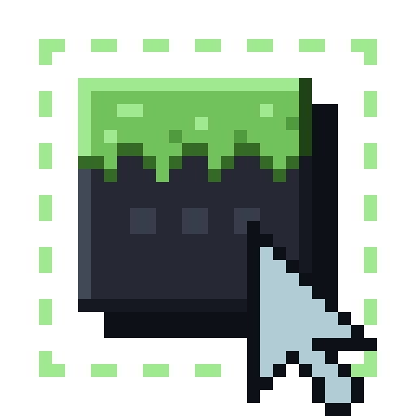

# MCDT: Minecraft DevTools

**Turn the running Minecraft client into a local API.**<br>
Read game state, send input, stream events and poke around the live object graph over REST, WebSocket or MCP. Any language works, and you don't need to write Java or restart the game.

[](https://github.com/Advik-B/minecraft-devtools/actions/workflows/build.yml)
[](https://github.com/Advik-B/minecraft-devtools/releases/latest)


[](LICENSE)

[Features](#features) | [Getting started](#getting-started) | [AI agents (MCP)](#use-it-from-an-ai-agent-mcp) | [API](#api-at-a-glance) | [Configuration](#configuration) | [Docker](#deploy-with-docker) | [Contributing](CONTRIBUTING.md)

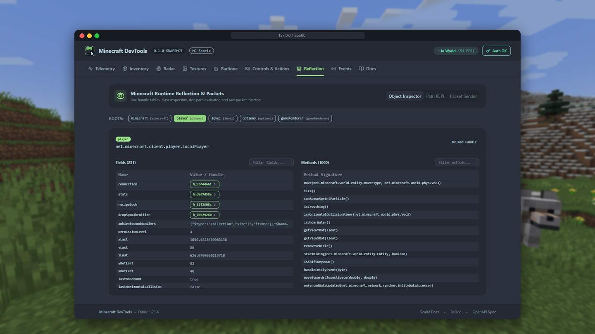

</div>

## Overview

MCDT is a **client-only mod for Fabric and NeoForge** (Minecraft 1.21.1 and 1.21.4, see [Compatibility](#compatibility)). Inside the game it runs a small HTTP server on `127.0.0.1:25580`, and that server exposes the live client as a REST API (with an OpenAPI spec), WebSocket streams and a built-in [Model Context Protocol](https://modelcontextprotocol.io) server. The Svelte dashboard is bundled in the same jar.

You can `curl` the game, script it from Python, or build an overlay in the browser. You can also hand it to an AI agent and let it play. You don't have to write a mod or attach a debugger, and nothing needs to scrape the screen.

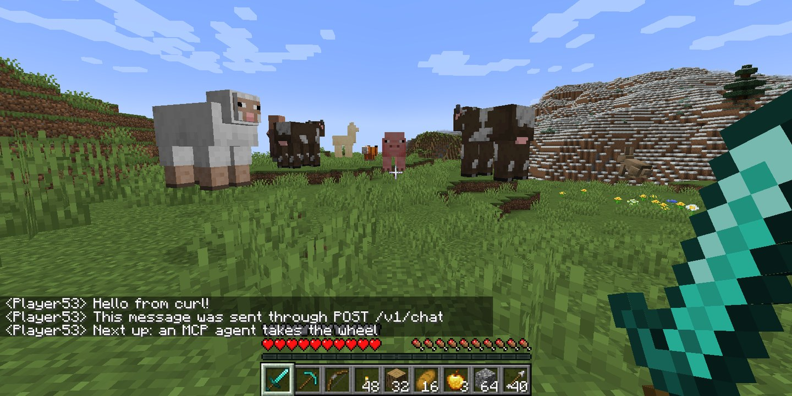

<sup>Every message in that chat box was sent with <code>curl</code>. The scene was set up the same way: the world was created by clicking title-screen widgets through <code>/v1/screen/actions</code>, and the animals were placed with commands sent to <code>/v1/chat</code>.</sup>

> [!WARNING]
> MCDT is an early `0.1.0-SNAPSHOT`, and automation can break a multiplayer server's rules. Out of the box it blocks write actions on any multiplayer server that isn't on your allowlist, but you're still responsible for how you use it.

## Features

- **Read everything.** Player, inventory, world, entities, block regions, raycasts, open screens and widgets, registries, options, skins, texture atlases, and framebuffer screenshots.
- **Drive the client.** Synthetic keyboard and mouse input, chat and commands, look/move/attack/use, clicks on GUI widgets and container slots, and option changes.
- **Live object graph.** Browse any object from named roots (`minecraft`, `player`, `level` and so on), follow dot-paths like `player.getInventory().items[0]`, read and write fields, invoke methods, or send raw serverbound packets.
- **Real-time events.** WebSocket streams for chat, screens, entity spawns and removals, block updates, damage and death, world join and leave, inbound packets, and ticks.
- **AI agents.** There's a native MCP server at `/mcp` with a set of hand-picked tools (`get_state`, `look`, `move`, `screenshot` and more), subscribable resources, and a stdio shim for desktop clients.
- **Optional Baritone.** Install the [Baritone](https://github.com/cabaletta/baritone) API jar for your loader and version (1.13.1 on 1.21.4, 1.11.3 on 1.21.1) and MCDT exposes goto, mine, follow, explore, farm and build as background jobs. Without it, those routes just return a `501`.
- **Proper dev tooling.** OpenAPI 3.1 at `/openapi.json`, offline Scalar and ReDoc docs, RFC 9457 problem responses, and per-day request logs in `logs/mcdt/`.
- **Safe by default.** Loopback only, a fresh bearer token every launch, Host and Origin checks, a rate limit, read-only permission until you opt in, and a reflection denylist that redacts session credentials.
- **Gentle on the game thread.** Every request crosses a bounded queue onto the client thread. The queue drains within a per-tick time budget (2 ms by default), and if it fills up, new requests get a `503` instead of piling up.

### The dashboard

Open `http://127.0.0.1:25580/` while the game is running.

| Telemetry | Radar |
| :---: | :---: |
| 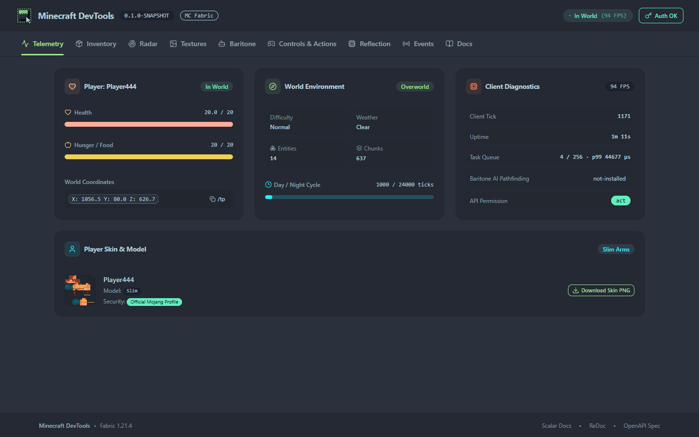 | 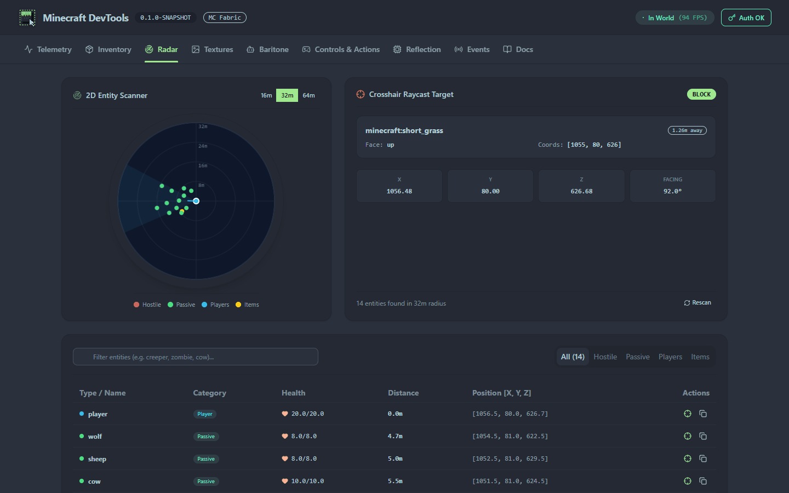 |
| **Inventory** | **Textures** |
| 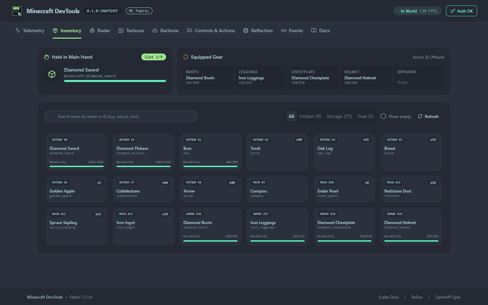 | 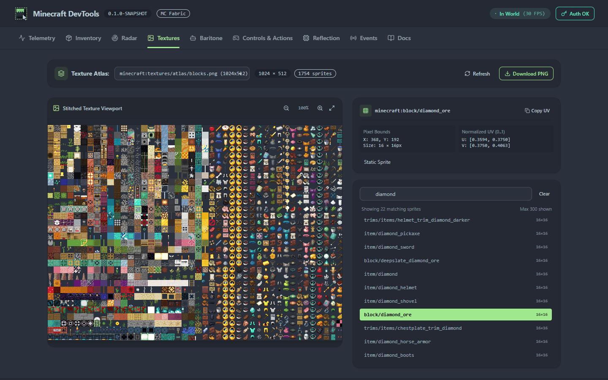 |
| **Reflection** | **Events** |
| 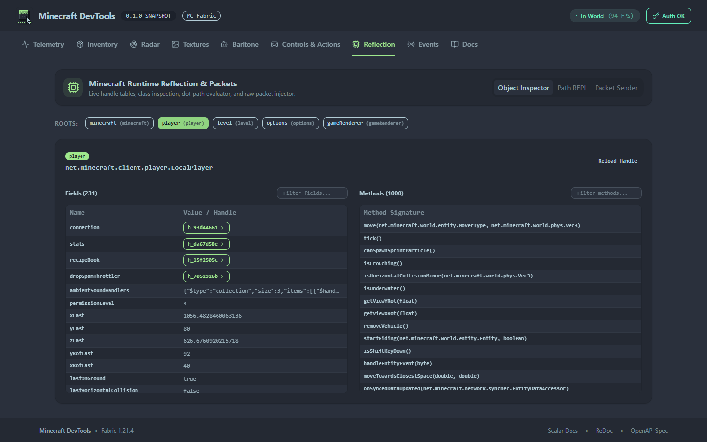 | 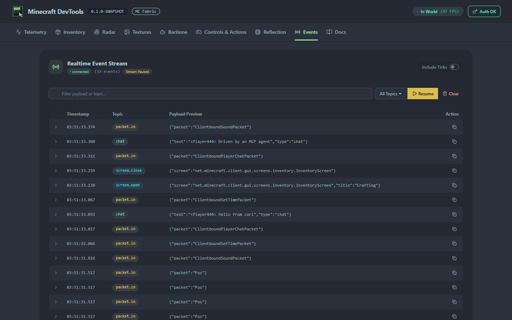 |
| **Controls & Actions** | **API docs** (`/docs/scalar`) |
| 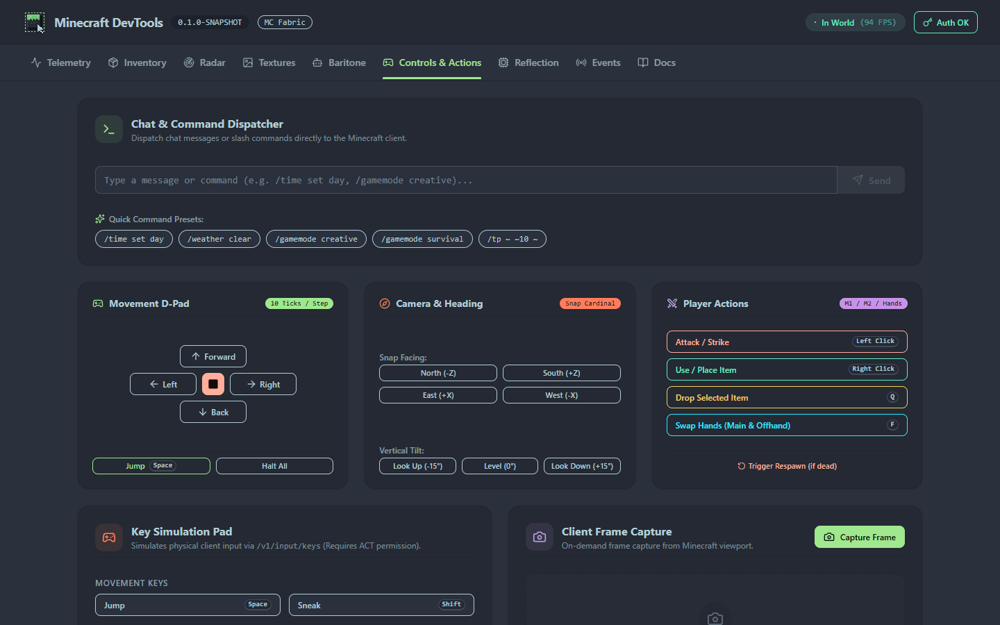 | 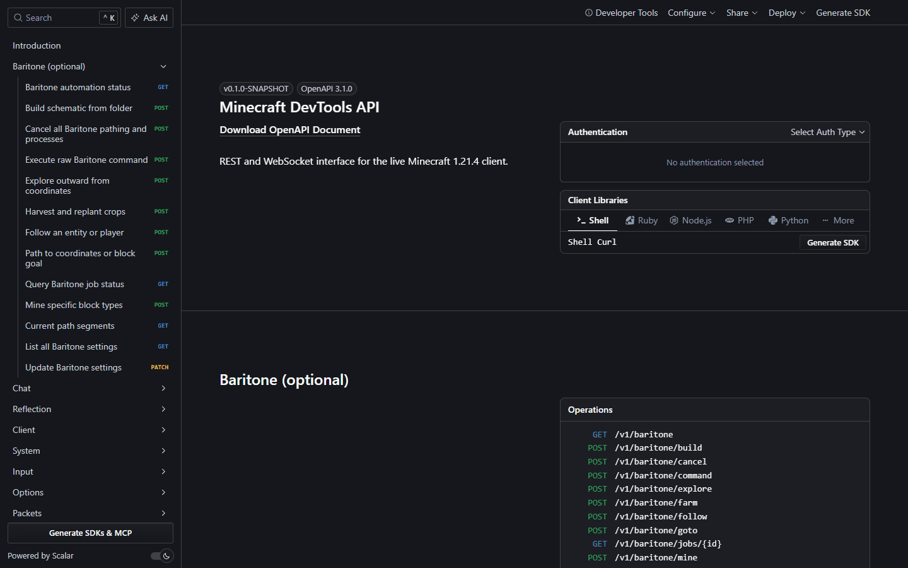 |

There's a Baritone tab aswell, which drives pathing, mining, and building when Baritone is installed.

## Getting started

### Compatibility

| Minecraft | Fabric | NeoForge |
|---|---|---|
| **1.21.4** | Loader 0.19.5+ with Fabric API | 21.4.161+ |
| **1.21.1** | Loader 0.19.5+ with Fabric API | 21.1.265+ |

Every combination is live-tested in CI on a real headless client, with and without Baritone. Features a version can't support are reported as off in `GET /v1/health` (`capabilities`), and their routes answer `501 feature-unavailable`. On **1.21.1**, `recipes` is off: `/v1/recipes` is built on the recipe display ids that arrived in 1.21.2.

### Prerequisites

- Minecraft **1.21.1** or **1.21.4** with [Fabric Loader](https://fabricmc.net/use/) **0.19.5+** and [Fabric API](https://modrinth.com/mod/fabric-api), or with [NeoForge](https://neoforged.net)
- Java **21** or newer
- Optional: [YACL 3](https://modrinth.com/mod/yacl) for an in-game config screen (on Fabric through [Mod Menu](https://modrinth.com/mod/modmenu), on NeoForge through the mod list), and the [Baritone](https://github.com/cabaletta/baritone) API jar for pathing

### Install

1. Download `mcdt-<version>+<minecraft>-<loader>.jar` for your Minecraft version and loader from [GitHub Releases](https://github.com/Advik-B/minecraft-devtools/releases/latest), for example `mcdt-1.1.0+1.21.4-neoforge.jar`.
2. Copy the jar into your `.minecraft/mods/` folder (next to Fabric API on Fabric).
3. Launch the game.

> [!TIP]
> Each release ships with a mod jar per Minecraft version and loader, the OpenAPI 3.1 specification (`openapi.json`), and SHA-256 checksums (`sha256sums.txt`). If you'd rather build from source or contribute, see [CONTRIBUTING.md](CONTRIBUTING.md).

### Make your first request

When the game starts, MCDT writes a discovery file with the port and bearer token to `~/.mcdt/instances/<pid>.json` (`%USERPROFILE%\.mcdt\instances\` on Windows). A copy also goes to `<gameDir>/config/mcdt/instance.json`.

```bash
INSTANCE=$(ls -t ~/.mcdt/instances/*.json | head -1)
BASE=$(jq -r .baseUrl "$INSTANCE")
TOKEN=$(jq -r .token "$INSTANCE")

curl -H "Authorization: Bearer $TOKEN" "$BASE/v1/health"
curl -H "Authorization: Bearer $TOKEN" "$BASE/v1/player"
curl -H "Authorization: Bearer $TOKEN" "$BASE/v1/screenshot?scale=0.5" -o frame.png
```

> [!NOTE]
> The token changes on every launch. Always send it in the `Authorization` header, because the REST API rejects tokens in query strings. WebSockets accept `?token=` only as a fallback for browsers.

To open the dashboard, go to `http://127.0.0.1:25580/` and paste the token when it asks. You can also append `#token=<TOKEN>` to the URL.

### Let it act

MCDT starts out read-only (`"permission": "read"`). To move the player, send chat, or click things, set `"permission": "act"` in `config/mcdt/config.json` or in the config screen. Then try:

```bash
curl -X POST -H "Authorization: Bearer $TOKEN" -H "Content-Type: application/json" -d '{"message":"Hello from curl!"}' "$BASE/v1/chat"

curl -X POST -H "Authorization: Bearer $TOKEN" -H "Content-Type: application/json" -d '{"forward":true,"jump":true,"ticks":20}' "$BASE/v1/player/move"
```

The [`http/`](http) folder has more ready-to-run requests for IntelliJ, VS Code REST Client, or any `.http` runner.

## Use it from an AI agent (MCP)

MCDT has a built-in MCP server at `/mcp`. `POST` takes JSON-RPC, and `GET` opens an SSE stream for resource notifications. Desktop clients that speak stdio connect through a small shim script. The shim finds the newest running instance and its token, so you don't have to update your config on each launch.

First, download the shim somewhere it can stay:

```bash
curl -fsSLo ~/mcdt-mcp.py https://raw.githubusercontent.com/Advik-B/minecraft-devtools/master/scripts/mcdt-mcp.py
```

Then point your client at it:

```jsonc
// claude_desktop_config.json, Cursor, Zed, ...
{
  "mcpServers": {
    "minecraft": {
      "command": "uv",
      "args": ["run", "--script", "/full/path/to/mcdt-mcp.py"]
    }
  }
}
```

For Claude Code: `claude mcp add minecraft -- uv run --script ~/mcdt-mcp.py`

The shim needs only [uv](https://docs.astral.sh/uv/): it has no dependencies, and uv provides the Python.

The shim accepts `--url`, `--token`, `--port`, and `--no-sse`. There's also a PowerShell version, [`mcdt-mcp.ps1`](scripts/mcdt-mcp.ps1), which takes `-BaseUrl`, `-Token`, and `-Port`.

| Tools | |
| --- | --- |
| Observe | `get_state`, `screenshot` (returns an MCP image), `raycast`, `get_player_skin`, `get_game_textures`, `inspect`, `job_status` |
| Act | `look`, `move`, `interact`, `inventory_click`, `screen_action`, `chat` |
| Baritone | `baritone_goto`, `baritone_mine`, `baritone_follow`, `baritone_cancel` (registered only when Baritone is installed) |
| Escape hatch | `rest_call`: call any `/v1/*` endpoint |

**Resources:** `mcdt://player`, `mcdt://inventory`, `mcdt://screen`, `mcdt://world`, `mcdt://hud`, and `mcdt://player/skin`. Subscribers get throttled `notifications/resources/updated` messages over SSE. `GET /v1/mcp/status` and `GET /v1/mcp/log` show sessions and recent tool calls.

> [!TIP]
> Tools still follow the configured permission. With the default `read`, an agent can look but not touch. Raise it to `act` when you want the agent to play.

## API at a glance

All routes live under `/v1`. For the complete and current list, check the live OpenAPI spec at `/docs/scalar`, `/docs/redoc`, or `/openapi.json`.

| Area | Endpoints | Min. permission |
| --- | --- | --- |
| System | `GET /health`, `GET /client`, `GET /mcp/status`, `GET /mcp/log` | read |
| Player | `GET /player`, `/player/inventory`, `/player/skin`, `/player/skin/info` | read |
| World | `GET /world`, `/world/blocks`, `/world/entities`, `/world/entities/categories`, `/world/raycast` | read |
| Screen & data | `GET /screen`, `/registries`, `/registries/{registry}`, `/options`, `/screenshot`, `/textures/atlases`, `/textures/atlas`, `/textures/atlas/image` | read |
| Chat | `GET /chat` (history), `POST /chat` | read / act |
| Input & actions | `POST /input/keys`, `/input/mouse`, `/player/look`, `/player/move`, `/player/actions`, `/screen/actions`, `/screen/slots`, `PATCH /options` | act |
| Session | `POST /session/quit`, then `POST /session/quit/confirm` with a single-use token that expires in 30 s | act |
| Reflection | `GET /objects/roots`, `/objects/{handle}`, `/objects/{handle}/fields/{name}`, `/classes/{name}`, `DELETE /objects/{handle}` | read |
| Reflection writes | `PUT /objects/{handle}/fields/{name}`, `POST /objects/{handle}/invoke`, `POST /packets` | reflect-write |
| Baritone | `GET /baritone`, `/baritone/status`, `/baritone/path`, `/baritone/jobs/{id}`, `/baritone/settings` | read |
| | `POST /baritone/goto`, `mine`, `follow`, `explore`, `farm`, `build`, `cancel`, `command`, `PATCH /baritone/settings` | act |

**WebSockets:** `/v1/events` (event bus), `/v1/player/status`, `/v1/player/inventory`, `/v1/world/stream`, `/v1/input/keys`, and `/v1/input/mouse`. To pick topics on `/v1/events`, send `{"action":"subscribe","topics":["chat","screen.open"]}`. The topics are `chat`, `screen.open`, `screen.close`, `world.join`, `world.leave`, `player.damage`, `player.death`, `entity.spawn`, `entity.remove`, `block.update`, `packet.in`, and `tick`, plus `baritone.path` and `baritone.process` when Baritone is installed.

**Errors** use [RFC 9457](https://www.rfc-editor.org/rfc/rfc9457) `application/problem+json` with stable `type` codes. For example, `409 no-world` means you are not in a world, `503 queue-full` means the queue is full, `504 timeout` means a tick deadline was missed, `501 baritone-not-installed` means Baritone is missing, and `403 multiplayer-write-disabled` means writes are blocked on that server.

## Configuration

Settings live in `<gameDir>/config/mcdt/config.json`. You can also edit them in-game through **Mods > Minecraft DevTools > Configure**, which needs Mod Menu and YACL. Most settings change the mod's behaviour live, but the ones marked *Requires a game restart* don't.

| Setting | Default | Description |
| --- | --- | --- |
| `permission` | `"read"` | Highest level granted to clients: `read`, `act`, or `reflect-write` |
| `allowedMultiplayerServers` | `[]` | Servers where `act` and `reflect-write` are allowed. `*` is a wildcard (`*.example.com`), and `*` alone allows every server |
| `originAllowlist` | `[]` | Extra browser origins, e.g. `http://localhost:5173` |
| `allowedHosts` | `[]` | Extra `Host` header names, e.g. a reverse proxy's domain |
| `preferredPort` / `bindAddress` | `25580` / `127.0.0.1` | Falls back to a random port if `25580` is taken |
| `requestTimeoutMs` | `5000` | How long a request waits for the client thread |
| `tickBudgetMicros` | `2000` | Time the queue may use per client tick |
| `enableMcp`, `enableBaritone`, `allowQuit` | `true` | Feature switches |
| `rateLimitPerSecond` | `200` | Per-client request rate limit |

> [!CAUTION]
> A wildcard in `allowedMultiplayerServers` lets API clients automate every matching server, and `*` lets them automate **any** server you join. Most servers ban automated clients, so this is a **huge ban risk** for your account. MCDT logs a loud warning at startup, when the list changes, and when you join a server that only a wildcard allows.
> Entries are matched against the address as it appears in your server list, port included if you typed one. So `*.example.com` does not match `play.example.com:25566`. Use `*.example.com*` to cover ports too.

The file also holds `enabled`, `queueCapacity`, `maxRequestBytes`, `eventRingBufferSize`, `eventSubscriberQueueCapacity`, `mcpLogCalls`, and `mcpNotificationThrottleMs`.

Environment variables override the file at startup. They are not written back to it, and an empty variable counts as unset.

| Variable | Overrides |
| --- | --- |
| `MCDT_PORT` | `preferredPort` |
| `MCDT_BIND_ADDRESS` | `bindAddress` |
| `MCDT_PERMISSION` | `permission` |
| `MCDT_ALLOW_QUIT` | `allowQuit` (`true` or `false`) |
| `MCDT_ALLOWED_HOSTS`, `MCDT_ORIGIN_ALLOWLIST`, `MCDT_ALLOWED_MULTIPLAYER_SERVERS` | The matching list, comma-separated |
| `MCDT_TOKEN` | A fixed bearer token of at least 32 characters, used instead of a random one per launch |

## Deploy with Docker

Want MCDT running on a server, or somewhere without a screen? There are Docker images for that. Each one runs a headless Minecraft client with MCDT and [Baritone](https://github.com/cabaletta/baritone) already installed (plus Fabric API on Fabric), and you talk to it over the same API.

### Pick an image

There's one image per Minecraft version and loader:

| Image | Minecraft | Loader |
| --- | --- | --- |
| `ghcr.io/advik-b/mcdt-1.21.4-fabric` | 1.21.4 | Fabric |
| `ghcr.io/advik-b/mcdt-1.21.4-neoforge` | 1.21.4 | NeoForge |
| `ghcr.io/advik-b/mcdt-1.21.1-fabric` | 1.21.1 | Fabric |
| `ghcr.io/advik-b/mcdt-1.21.1-neoforge` | 1.21.1 | NeoForge |

Tags: `latest` is the newest release, `1.1.0` and so on are fixed releases, and `edge` is the latest `master` build. Every image passes the full live test suite in CI before it's published.

The client draws to a virtual display (Xvfb) with software OpenGL (Mesa llvmpipe), so screenshots and texture endpoints still work. You don't need a GPU. The images are tested on `linux/amd64`.

### Start it with `docker run`

```sh
docker run -d --name mcdt -p 127.0.0.1:25580:25580 -v mcdt-data:/data \
  -e MCDT_TOKEN="$(openssl rand -hex 32)" -e MCDT_PERMISSION=act \
  ghcr.io/advik-b/mcdt-1.21.4-fabric:latest
```

The images don't contain Minecraft. On the first start the container downloads the game, the loader and the assets into the `/data` volume. That takes a few minutes, and later starts reuse the files. Run `docker logs -f mcdt` if you want to watch. Once the API is up, the container shows as `healthy`.

If you didn't set `MCDT_TOKEN`, MCDT picks a random one. Read it with `docker exec mcdt cat /data/config/mcdt/token`.

### Or use Docker Compose

Grab [`docker-compose.yml`](docker-compose.yml) and put a `.env` file next to it:

```sh
MCDT_NODE=1.21.4-fabric      # which image to run
MCDT_TAG=latest
MCDT_TOKEN=paste-a-long-random-string-here
MCDT_PERMISSION=act
```

Then start it:

```sh
docker compose up -d
```

Every variable in the tables below can go in `.env` too.

### Connect to a world or server

The client starts on the title screen. From there you drive it through the API, like any other MCDT instance:

```sh
TOKEN=...   # your MCDT_TOKEN
curl -H "Authorization: Bearer $TOKEN" http://127.0.0.1:25580/v1/client
curl -H "Authorization: Bearer $TOKEN" -H "Content-Type: application/json" \
  -d '{"address":"mc.example.com:25565"}' http://127.0.0.1:25580/v1/servers/connect
```

You can also set `MC_JOIN_SERVER` or `MC_JOIN_WORLD` to join something as soon as the game starts. The dashboard is at `http://127.0.0.1:25580/` as usual.

**Offline accounts** only work in singleplayer and on servers with `online-mode=false`. To use a **Microsoft account**, set `MC_AUTH=microsoft` and watch `docker logs -f mcdt` on the first start. It prints a link and a code to sign in with. The login is saved in the `/data` volume, so you only do this once.

### Environment variables

| Variable | Default | Description |
| --- | --- | --- |
| `MC_AUTH` | `offline` | `offline`, or `microsoft` for a real account |
| `MC_BARITONE` | `true` | Load the bundled Baritone. `false` leaves it out, and `/v1/baritone/*` then returns `501` |
| `MC_MODRINTH` | | Modrinth projects to install, comma-separated: `slug` (newest version for the image) or `slug:version` |
| `MC_MODS` | | Mod jar URLs to download, comma-separated |
| `MC_USERNAME` | `McdtBot` | Offline player name. With `microsoft`, picks a stored account by name |
| `MC_MAX_MEMORY` | `2G` | Game heap (`-Xmx`) |
| `MC_JVM_ARGS` | | Extra JVM arguments, space-separated |
| `MC_WIDTH` / `MC_HEIGHT` | `1280` / `720` | Virtual screen and window size |
| `MC_JOIN_SERVER` (+ `MC_JOIN_SERVER_PORT`) / `MC_JOIN_WORLD` | | Optional: join a server or saved world at startup |
| `MCDT_*` | see [Configuration](#configuration) | MCDT settings. The image sets `MCDT_BIND_ADDRESS=0.0.0.0` |

`/data` is the game directory. It holds `config/mcdt/`, `logs/`, `saves/`, `options.txt`, and `mods/`.

The Baritone routes that start jobs (`goto`, `mine`, `follow` and so on) need `MCDT_PERMISSION=act` or higher. On a multiplayer server they also need that server in `MCDT_ALLOWED_MULTIPLAYER_SERVERS`. Baritone is LGPL-3.0 and ships unmodified.

### Add mods

Use any mix of these. They're all applied on each start, so to remove a mod, take it out and restart the container.

- **From Modrinth:** `-e MC_MODRINTH=sodium,lithium,yacl:3.8.1+1.21.4-fabric`. The container picks the file for the image's Minecraft version and loader, checks its SHA-512, and also installs the mods it requires.
- **From a URL:** `-e MC_MODS=https://example.com/my-mod-1.0.jar`.
- **From a folder:** `-v ./mods:/mods:ro`. The container copies every `.jar` in that folder.
- **By hand:** put jars in `/data/mods`. The container never touches jars that it didn't install.

If a mod can't be found or downloaded, the container stops and tells you which one. Mods have to match the image's loader and Minecraft version.

### Update

Pull the new image and recreate the container. Your game files, config, saves and login live in `/data`, so they carry over.

```sh
docker compose pull && docker compose up -d
```

With plain `docker run`, run `docker pull` on the image, then `docker rm -f mcdt` and start it again with the same command.

### Reach it from other machines

> [!CAUTION]
> Inside the container the API binds to `0.0.0.0`, but the examples above publish it only on the host's loopback. To reach it from other machines, put a TLS reverse proxy in front of it and set `MCDT_ALLOWED_HOSTS` to the proxy's host name, plus `MCDT_ORIGIN_ALLOWLIST` if you use the dashboard. Always set a strong `MCDT_TOKEN`. Anyone with the token and `act` permission controls the client. `act` and `reflect-write` stay blocked on multiplayer servers that are not in `MCDT_ALLOWED_MULTIPLAYER_SERVERS`.

## Contributing

Bug reports and pull requests are welcome. [CONTRIBUTING.md](CONTRIBUTING.md) covers building from source, running the tests, and how the project is laid out.

Built with [Fabric](https://fabricmc.net), [NeoForge](https://neoforged.net), [Stonecutter](https://stonecutter.kikugie.dev), [Javalin](https://javalin.io), [Jackson](https://github.com/FasterXML/jackson), [Scalar](https://scalar.com), [Svelte](https://svelte.dev), and [daisyUI](https://daisyui.com).

## License

MIT. See [LICENSE](LICENSE).
