<div align="center">

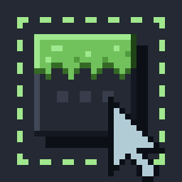

# MCDT: Minecraft DevTools

**Turn the running Minecraft client into a local API.**<br>
Read game state, send input, stream events and poke around the live object graph over REST, WebSocket or MCP. Any language works, and you don't need to write Java or restart the game.

[](https://github.com/Advik-B/minecraft-devtools/actions/workflows/build.yml)
[](https://github.com/Advik-B/minecraft-devtools/releases/latest)


[](LICENSE)

[Features](#features) | [Getting started](#getting-started) | [AI agents (MCP)](#use-it-from-an-ai-agent-mcp) | [API](#api-at-a-glance) | [Configuration](#configuration) | [Development](#development)

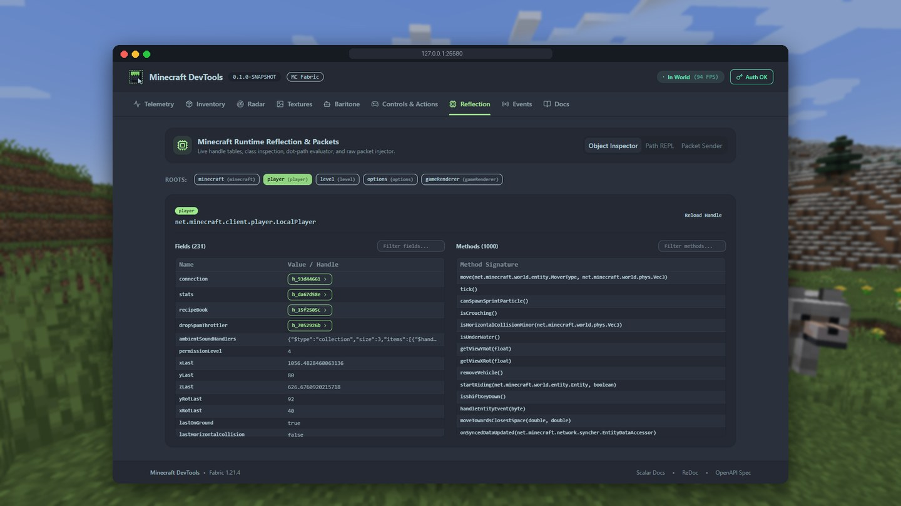

</div>

## Overview

MCDT is a **client-only Fabric mod**. Inside the game it runs a small HTTP server on `127.0.0.1:25580`, and that server exposes the live client as a REST API (with an OpenAPI spec), WebSocket streams and a built-in [Model Context Protocol](https://modelcontextprotocol.io) server. The Svelte dashboard is bundled in the same jar.

You can `curl` the game, script it from Python, or build an overlay in the browser. You can also hand it to an AI agent and let it play. You don't have to write a mod or attach a debugger, and nothing needs to scrape the screen.

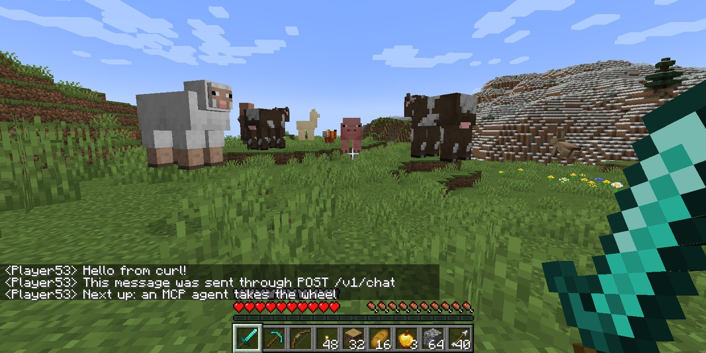

<sup>Every message in that chat box was sent with <code>curl</code>. The scene was set up the same way: the world was created by clicking title-screen widgets through <code>/v1/screen/actions</code>, and the animals were placed with commands sent to <code>/v1/chat</code>.</sup>

> [!WARNING]
> MCDT is an early `0.1.0-SNAPSHOT`, and automation can break a multiplayer server's rules. Out of the box it blocks write actions on any multiplayer server that isn't on your allowlist, but you're still responsible for how you use it.

## Features

- **Read everything.** Player, inventory, world, entities, block regions, raycasts, open screens and widgets, registries, options, skins, texture atlases, and framebuffer screenshots.
- **Drive the client.** Synthetic keyboard and mouse input, chat and commands, look/move/attack/use, clicks on GUI widgets and container slots, and option changes.
- **Live object graph.** Browse any object from named roots (`minecraft`, `player`, `level` and so on), follow dot-paths like `player.getInventory().items[0]`, read and write fields, invoke methods, or send raw serverbound packets.
- **Real-time events.** WebSocket streams for chat, screens, entity spawns and removals, block updates, damage and death, world join and leave, inbound packets, and ticks.
- **AI agents.** There's a native MCP server at `/mcp` with a set of hand-picked tools (`get_state`, `look`, `move`, `screenshot` and more), subscribable resources, and a stdio shim for desktop clients.
- **Optional Baritone.** Install [Baritone](https://github.com/cabaletta/baritone) 1.13.1 and MCDT exposes goto, mine, follow, explore, farm and build as background jobs. Without it, those routes just return a `501`.
- **Proper dev tooling.** OpenAPI 3.1 at `/openapi.json`, offline Scalar and ReDoc docs, RFC 9457 problem responses, and per-day request logs in `logs/mcdt/`.
- **Safe by default.** Loopback only, a fresh bearer token every launch, Host and Origin checks, a rate limit, read-only permission until you opt in, and a reflection denylist that redacts session credentials.
- **Gentle on the game thread.** Every request crosses a bounded queue onto the client thread. The queue drains within a per-tick time budget (2 ms by default), and if it fills up, new requests get a `503` instead of piling up.

### The dashboard

Open `http://127.0.0.1:25580/` while the game is running.

| Telemetry | Radar |
| :---: | :---: |
| 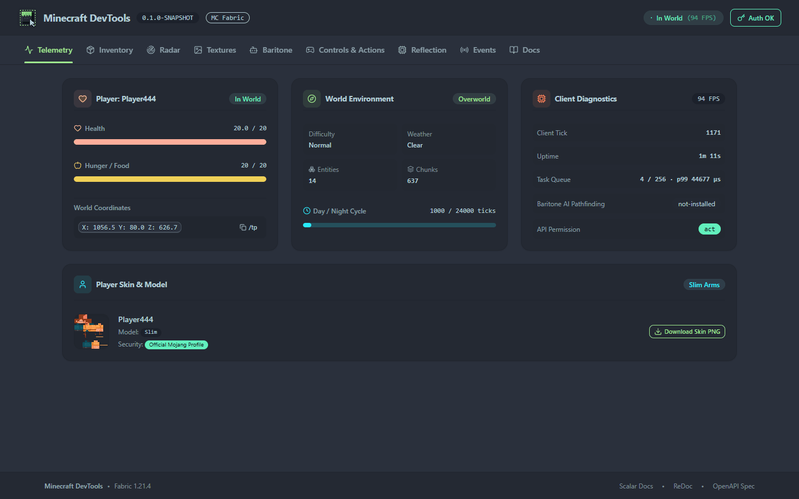 | 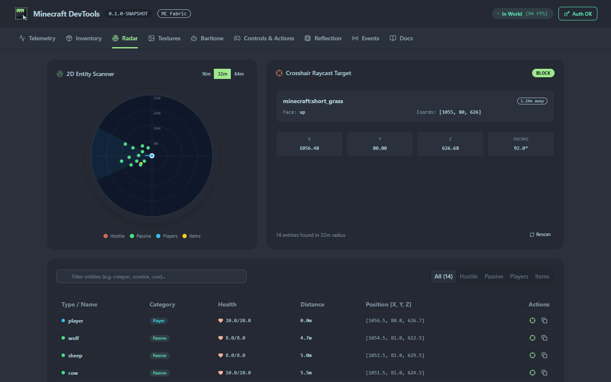 |
| **Inventory** | **Textures** |
| 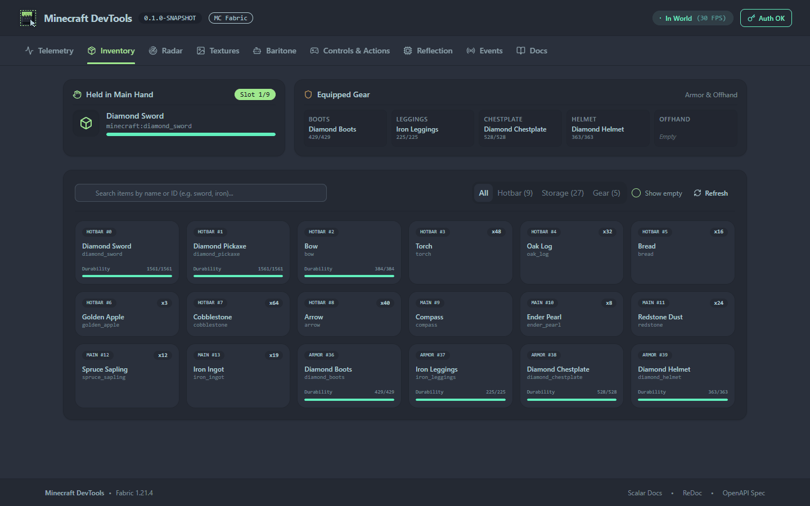 | 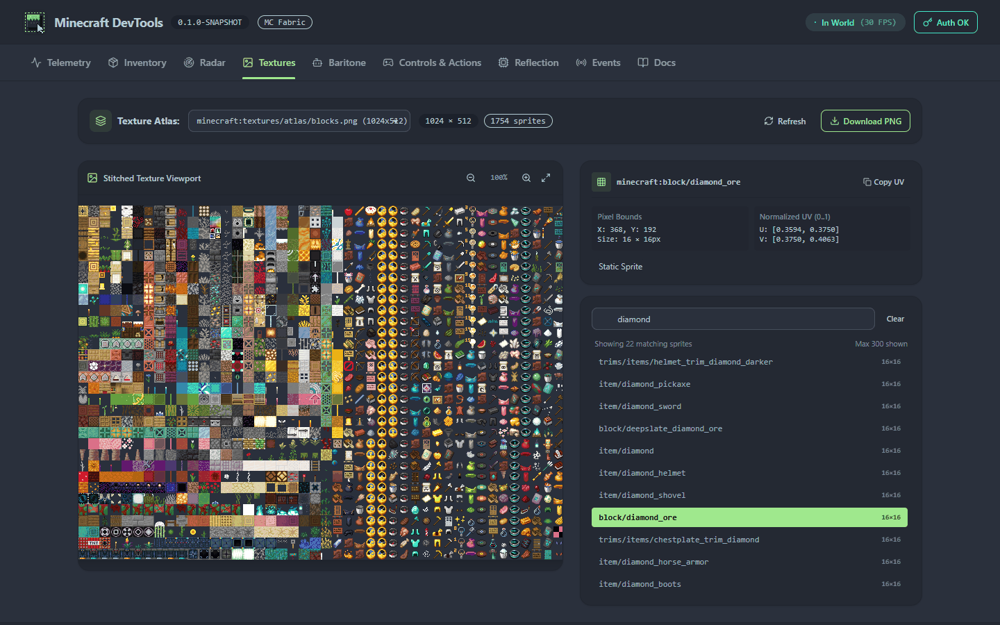 |
| **Reflection** | **Events** |
| 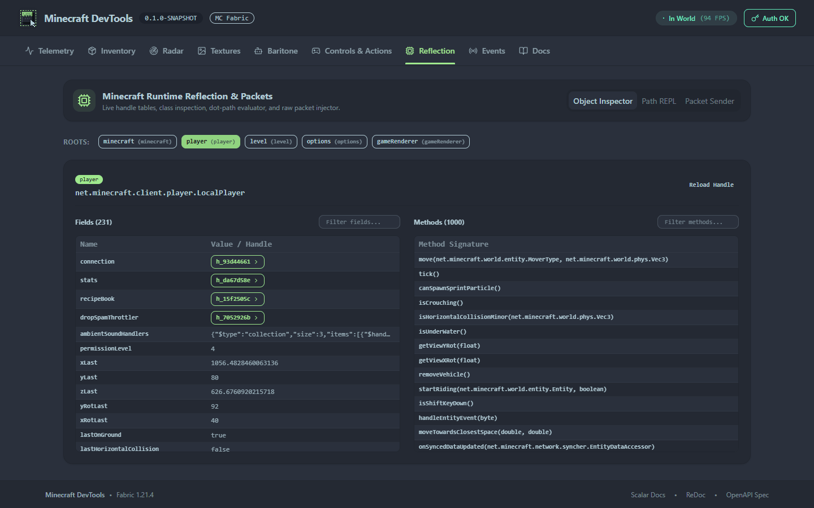 | 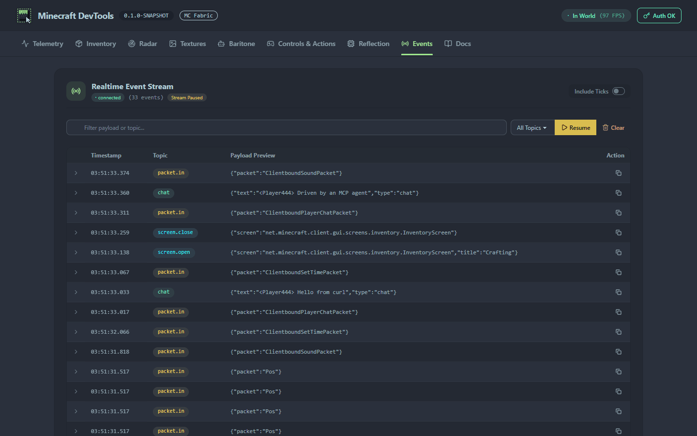 |
| **Controls & Actions** | **API docs** (`/docs/scalar`) |
| 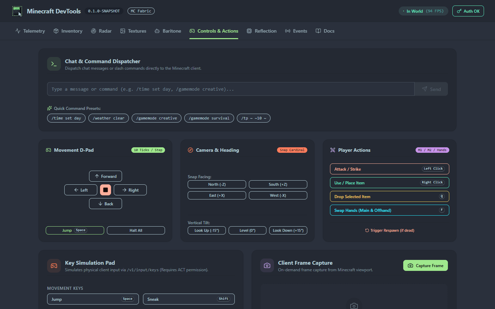 | 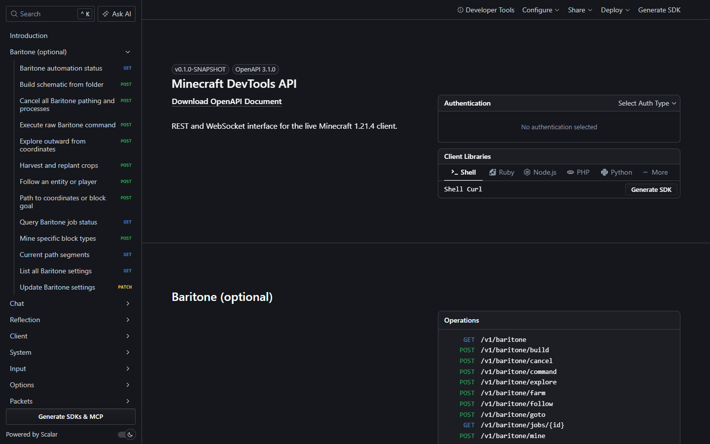 |

There's a Baritone tab aswell, which drives pathing, mining, and building when Baritone is installed.

## Getting started

### Prerequisites

- Minecraft **1.21.4** with [Fabric Loader](https://fabricmc.net/use/) **0.19.5+** and [Fabric API](https://modrinth.com/mod/fabric-api)
- Java **21** or newer
- Optional: [Mod Menu](https://modrinth.com/mod/modmenu) + [YACL 3](https://modrinth.com/mod/yacl) for an in-game config screen, and [Baritone](https://github.com/cabaletta/baritone) 1.13.1 for pathing

### Install

1. Download the latest `mcdt-<version>.jar` from [GitHub Releases](https://github.com/Advik-B/minecraft-devtools/releases/latest).
2. Copy the jar into your `.minecraft/mods/` folder next to Fabric API.
3. Launch the game.

> [!TIP]
> Each release ships with the compiled mod jar, the sources jar, the OpenAPI 3.1 specification (`openapi.json`), and SHA-256 checksums (`sha256sums.txt`). If you'd rather build from source or contribute, see [Development](#development).

### Make your first request

When the game starts, MCDT writes a discovery file with the port and bearer token to `~/.mcdt/instances/<pid>.json` (`%USERPROFILE%\.mcdt\instances\` on Windows). A copy also goes to `<gameDir>/config/mcdt/instance.json`.

```bash
INSTANCE=$(ls -t ~/.mcdt/instances/*.json | head -1)
BASE=$(jq -r .baseUrl "$INSTANCE")
TOKEN=$(jq -r .token "$INSTANCE")

curl -H "Authorization: Bearer $TOKEN" "$BASE/v1/health"
curl -H "Authorization: Bearer $TOKEN" "$BASE/v1/player"
curl -H "Authorization: Bearer $TOKEN" "$BASE/v1/screenshot?scale=0.5" -o frame.png
```

> [!NOTE]
> The token changes on every launch. Always send it in the `Authorization` header, because the REST API rejects tokens in query strings. WebSockets accept `?token=` only as a fallback for browsers.

To open the dashboard, go to `http://127.0.0.1:25580/` and paste the token when it asks. You can also append `#token=<TOKEN>` to the URL.

### Let it act

MCDT starts out read-only (`"permission": "read"`). To move the player, send chat, or click things, set `"permission": "act"` in `config/mcdt/config.json` or in the config screen. Then try:

```bash
curl -X POST -H "Authorization: Bearer $TOKEN" -H "Content-Type: application/json" -d '{"message":"Hello from curl!"}' "$BASE/v1/chat"

curl -X POST -H "Authorization: Bearer $TOKEN" -H "Content-Type: application/json" -d '{"forward":true,"jump":true,"ticks":20}' "$BASE/v1/player/move"
```

The [`http/`](http) folder has more ready-to-run requests for IntelliJ, VS Code REST Client, or any `.http` runner.

## Use it from an AI agent (MCP)

MCDT has a built-in MCP server at `/mcp`. `POST` takes JSON-RPC, and `GET` opens an SSE stream for resource notifications. Desktop clients that speak stdio connect through the shim in [`scripts/`](scripts). The shim finds the newest running instance and its token, so you don't have to update your config on each launch.

```jsonc
// claude_desktop_config.json, Cursor, Zed, ...
{
  "mcpServers": {
    "minecraft": {
      "command": "python",
      "args": ["/path/to/minecraft-devtools/scripts/mcdt-mcp.py"]
    }
  }
}
```

For Claude Code: `claude mcp add minecraft -- python /path/to/minecraft-devtools/scripts/mcdt-mcp.py`

The shim accepts `--url`, `--token`, `--port`, and `--no-sse`. There's also a PowerShell version, `mcdt-mcp.ps1`, which takes `-BaseUrl`, `-Token`, and `-Port`.

| Tools | |
| --- | --- |
| Observe | `get_state`, `screenshot` (returns an MCP image), `raycast`, `get_player_skin`, `get_game_textures`, `inspect`, `job_status` |
| Act | `look`, `move`, `interact`, `inventory_click`, `screen_action`, `chat` |
| Baritone | `baritone_goto`, `baritone_mine`, `baritone_follow`, `baritone_cancel` (registered only when Baritone is installed) |
| Escape hatch | `rest_call`: call any `/v1/*` endpoint |

**Resources:** `mcdt://player`, `mcdt://inventory`, `mcdt://screen`, `mcdt://world`, `mcdt://hud`, and `mcdt://player/skin`. Subscribers get throttled `notifications/resources/updated` messages over SSE. `GET /v1/mcp/status` and `GET /v1/mcp/log` show sessions and recent tool calls.

> [!TIP]
> Tools still follow the configured permission. With the default `read`, an agent can look but not touch. Raise it to `act` when you want the agent to play.

## API at a glance

All routes live under `/v1`. For the complete and current list, check the live OpenAPI spec at `/docs/scalar`, `/docs/redoc`, or `/openapi.json`.

| Area | Endpoints | Min. permission |
| --- | --- | --- |
| System | `GET /health`, `GET /client`, `GET /mcp/status`, `GET /mcp/log` | read |
| Player | `GET /player`, `/player/inventory`, `/player/skin`, `/player/skin/info` | read |
| World | `GET /world`, `/world/blocks`, `/world/entities`, `/world/entities/categories`, `/world/raycast` | read |
| Screen & data | `GET /screen`, `/registries`, `/registries/{registry}`, `/options`, `/screenshot`, `/textures/atlases`, `/textures/atlas`, `/textures/atlas/image` | read |
| Chat | `GET /chat` (history), `POST /chat` | read / act |
| Input & actions | `POST /input/keys`, `/input/mouse`, `/player/look`, `/player/move`, `/player/actions`, `/screen/actions`, `/screen/slots`, `PATCH /options` | act |
| Session | `POST /session/quit`, then `POST /session/quit/confirm` with a single-use token that expires in 30 s | act |
| Reflection | `GET /objects/roots`, `/objects/{handle}`, `/objects/{handle}/fields/{name}`, `/classes/{name}`, `DELETE /objects/{handle}` | read |
| Reflection writes | `PUT /objects/{handle}/fields/{name}`, `POST /objects/{handle}/invoke`, `POST /packets` | reflect-write |
| Baritone | `GET /baritone`, `/baritone/status`, `/baritone/path`, `/baritone/jobs/{id}`, `/baritone/settings` | read |
| | `POST /baritone/goto`, `mine`, `follow`, `explore`, `farm`, `build`, `cancel`, `command`, `PATCH /baritone/settings` | act |

**WebSockets:** `/v1/events` (event bus), `/v1/player/status`, `/v1/player/inventory`, `/v1/world/stream`, `/v1/input/keys`, and `/v1/input/mouse`. To pick topics on `/v1/events`, send `{"action":"subscribe","topics":["chat","screen.open"]}`. The topics are `chat`, `screen.open`, `screen.close`, `world.join`, `world.leave`, `player.damage`, `player.death`, `entity.spawn`, `entity.remove`, `block.update`, `packet.in`, and `tick`, plus `baritone.path` and `baritone.process` when Baritone is installed.

**Errors** use [RFC 9457](https://www.rfc-editor.org/rfc/rfc9457) `application/problem+json` with stable `type` codes. For example, `409 no-world` means you are not in a world, `503 queue-full` means the queue is full, `504 timeout` means a tick deadline was missed, `501 baritone-not-installed` means Baritone is missing, and `403 multiplayer-write-disabled` means writes are blocked on that server.

## Configuration

Settings live in `<gameDir>/config/mcdt/config.json`. You can also edit them in-game through **Mods > Minecraft DevTools > Configure**, which needs Mod Menu and YACL. Most settings change the mod's behaviour live, but the ones marked *Requires a game restart* don't.

| Setting | Default | Description |
| --- | --- | --- |
| `permission` | `"read"` | Highest level granted to clients: `read`, `act`, or `reflect-write` |
| `allowedMultiplayerServers` | `[]` | Servers where `act` and `reflect-write` are allowed |
| `originAllowlist` | `[]` | Extra browser origins, e.g. `http://localhost:5173` |
| `preferredPort` / `bindAddress` | `25580` / `127.0.0.1` | Falls back to a random port if `25580` is taken |
| `requestTimeoutMs` | `5000` | How long a request waits for the client thread |
| `tickBudgetMicros` | `2000` | Time the queue may use per client tick |
| `enableMcp`, `enableBaritone`, `allowQuit` | `true` | Feature switches |
| `rateLimitPerSecond` | `200` | Per-client request rate limit |

The file also holds `enabled`, `queueCapacity`, `maxRequestBytes`, `eventRingBufferSize`, `eventSubscriberQueueCapacity`, `mcpLogCalls`, and `mcpNotificationThrottleMs`.

## Development

> [!IMPORTANT]
> The Gradle build compiles the dashboard, so **[Bun](https://bun.sh) must be on your `PATH`**. A cold build also needs network access to fetch and verify the pinned Baritone and Scalar artifacts.

```bash
./gradlew build                 # mod jar with the dashboard and all libraries bundled (jar-in-jar)
./gradlew test                  # JUnit 5 suite (no Minecraft needed) + JaCoCo report
./gradlew runClient             # dev client in ./run with Mod Menu + YACL
pwsh scripts/test-live-client.ps1   # smoke-test a running dev client
```

To work on the dashboard with hot reload:

```bash
cd web
bun install
bun run dev        # Vite on :5173, proxies /v1, /mcp and /docs to :25580
bun run check      # type-check
```

Add `http://localhost:5173` to `originAllowlist`, or the API rejects the dev server's requests.

### Project layout

```
src/main/java/dev/advik/mcdt/
  api/v1/        one handler per route group, annotated with @OpenApi
  game/          GameClient seam + the real Minecraft implementation
  exec/          bounded task queue drained on the client tick
  http/          Javalin server, routes, WebSockets, RFC 9457 problems
  security/      bearer auth, Host/Origin checks, rate limiting, roles
  reflection/    handle table, path evaluator, Mojang name mapping, denylist
  events/        lock-free event hub behind /v1/events
  mcp/           JSON-RPC MCP server, tools and resources
  baritone/      optional integration (only bridge/ touches Baritone)
web/             Svelte 5 + Tailwind 4 + daisyUI dashboard
scripts/         MCP stdio shims and the live-client test runner
http/            sample requests per area
```

Built with [Fabric](https://fabricmc.net), [Javalin](https://javalin.io), [Jackson](https://github.com/FasterXML/jackson), [Scalar](https://scalar.com), [Svelte](https://svelte.dev), and [daisyUI](https://daisyui.com).

For the design, architecture and roadmap, [MCDT.md](MCDT.md) is the place to look, though parts of it describe features that are planned but not built yet. If you're contributing, or you're a coding agent, start with [AGENTS.md](AGENTS.md).
